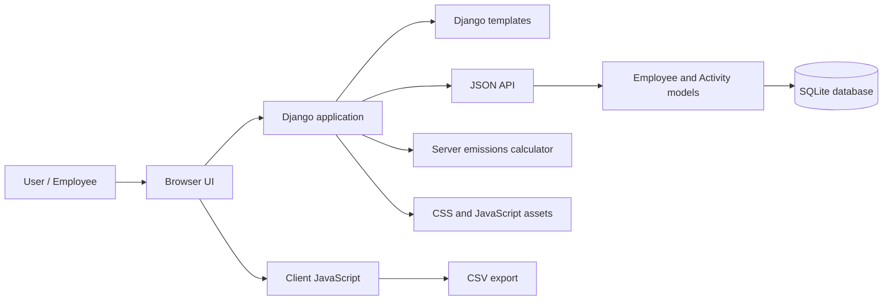
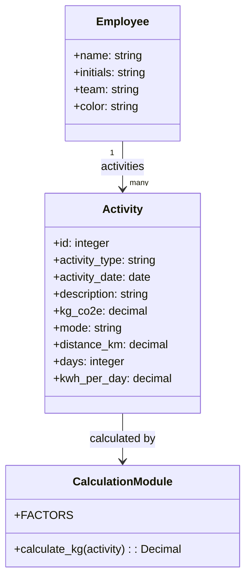
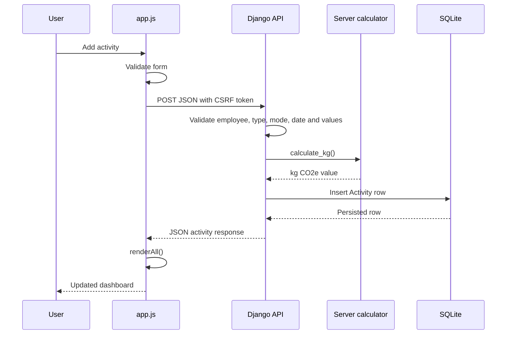
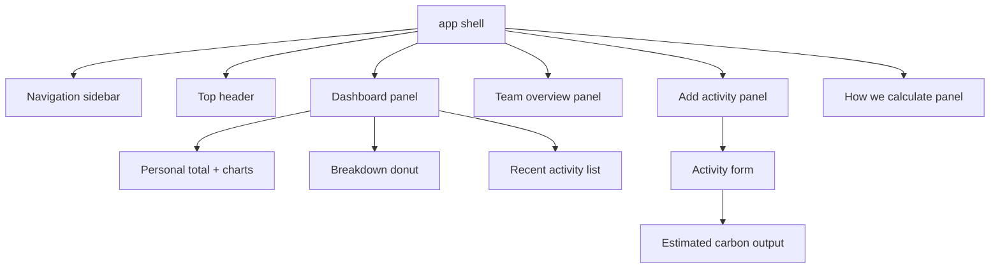
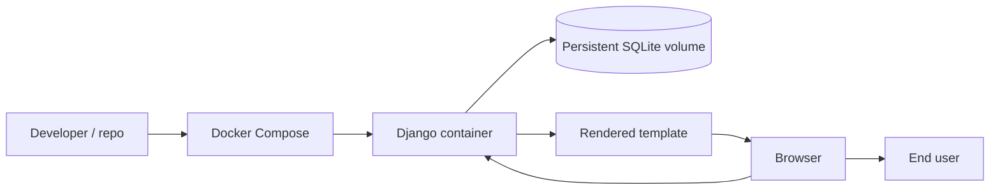
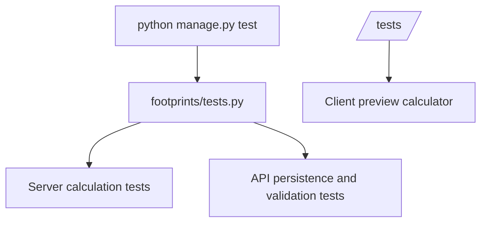

# Goodfoot Architecture

This document describes the architecture of the Goodfoot Django application: a carbon-footprint dashboard for employees and teams backed by SQLite.

## 1. Architectural summary

Goodfoot uses Django to serve the dashboard, validate activity submissions, calculate emissions, and persist employee and activity records in SQLite. The browser retains the presentation layer and calls a small JSON API; it does not keep the authoritative activity data.

The application intentionally keeps the architecture simple:

- Django templates render the HTML shell and serve the static CSS and JavaScript.
- JavaScript owns client-side navigation, charts, form previews, and CSV downloads.
- Django models and migrations define and seed the SQLite-backed data.
- Server-side validation and calculation are authoritative when creating activity entries.
- Django tests cover the calculation service and API.

## 2. System context



### Responsibilities

- `templates/goodfoot/index.html`: page shell, navigation, forms, and content areas.
- `static/goodfoot/styles.css`: visual design, layout, charts, cards, and responsive styling.
- `static/goodfoot/app.js`: client rendering, navigation, estimate preview, and CSV export.
- `footprints/models.py`: employee and activity database models.
- `footprints/views.py`: dashboard and JSON API endpoints.
- `footprints/calculations.py`: authoritative emissions factors and calculation logic.
- `data/db.sqlite3`: local SQLite database (created by migrations).
- `footprints/tests.py`: Django tests for calculations and API behavior.

## 3. Runtime architecture

```mermaid
flowchart TD
    A[Page load] --> B[init()]
    B --> C[fillEmployeeSelect()]
    B --> D[renderTypeFields()]
    B --> E[renderAll()]
    E --> F[renderPersonal()]
    E --> G[renderTeam()]

    F --> H[totalsFor()]
    F --> I[renderTrend()]
    F --> J[renderDonut()]
    F --> K[renderRecent()]

    L[User submits activity form] --> M[getFormEntry()]
    M --> N[POST /api/activities/]
    N --> O[Django validates input]
    O --> P[Server calculate_kg()]
    P --> Q[SQLite Activity row]
    Q --> R[Return created activity]
    R --> S[renderAll()]

    R[User exports CSV] --> S[downloadCsv()]
    S --> T[Blob + download link]
```

### Key runtime behaviors

1. The app boots on page load via `init()` and fetches employees and activities from Django.
2. The dashboard renders employee totals and team aggregates from API response data.
3. The activity form collects values for commute, work travel, or remote energy.
4. JavaScript previews the estimate; on submit Django independently validates and calculates it.
5. Django persists accepted entries in SQLite and returns the created entry to the browser.
6. The app exports either the personal activity log or aggregated team summary as CSV.

## 4. Domain model

The application centers on a single activity entry structure.



### Entry types

- `commute`: return-trip commute distance × days × mode factor
- `travel`: total work-trip distance × mode factor
- `remote`: daily energy consumption × days × electricity factor

## 5. Data and persistence flow



### Persistence model

Activity state is persisted in SQLite:

- `Employee` records identify the demo employees and teams.
- `Activity` rows retain the input values, date, description, and calculated emissions.
- `python manage.py migrate` creates the tables and seeds the initial demo dataset.
- Docker Compose mounts the database file in the named `goodfoot_data` volume.

Entries are shared by users of the same Django instance. SQLite and the included development server are intended for local demonstrations, not high-concurrency or production use.

## 6. UI composition

The interface is structured as a static dashboard with multiple panels:



### Main UI responsibilities

- `My footprint`: personal totals, trend chart, donutchart, recent log
- `Team overview`: aggregated group totals and participation statistics
- `Add activity`: form inputs for commute, travel, and remote work entries
- `How we calculate`: explanatory view for factors and assumptions

## 7. Calculation module design

The calculation logic is intentionally isolated in a small, pure module so formulas remain easy to document and test.

```mermaid
flowchart LR
    Entry[Activity entry] --> Calc[calculateKg(entry)]
    Calc --> Commute[commute factor]
    Calc --> Travel[travel factor]
    Calc --> Remote[remote energy factor]
    Commute --> Output[Total kg CO2e]
    Travel --> Output
    Remote --> Output
```

### Emission factors

Illustrative factors are declared on the server in `footprints/calculations.py`; the browser calculator mirrors them only for the live estimate preview:

- Commute: car 0.192, bus 0.105, train 0.041, bike 0, walk 0
- Travel: car 0.192, train 0.035, flight 0.255
- Remote energy: 0.207 kg CO2e/kWh

These values are placeholders for prototype demonstration and are not production-grade emissions factors.

## 8. Deployment model



### Deployment characteristics

- `docker-compose.yml` builds and runs the Django application on port 8080.
- SQLite data persists in a named Docker volume across container recreation.
- Migrations run when the Compose service starts.
- The prototype intentionally has no authentication or authorization; do not expose it publicly.

## 9. Testing architecture

The project includes Django tests and a lightweight browser test page for the calculation formulas.



The tests cover:

- commute impacts and mode weighting
- travel distances and flight factors
- remote-energy calculations
- negative and missing input handling
- API writes and invalid input rejection

## 10. Architectural trade-offs

### Strengths

- Simple local setup with Python and SQLite
- Server-side validation and authoritative emissions calculations
- Shared persisted data across browsers using one server instance
- Clear separation between Django data handling and browser presentation

### Constraints

- No authentication or access control
- SQLite and Django's development server are not production deployment settings
- Calculation factors are illustrative and not audited for regulatory or reporting use

## 11. Recommended future evolution

A production version would likely add:

- a backend API with authenticated user accounts
- a relational or document database for team data
- scheduled jobs or reporting pipelines for emissions analysis
- stronger validation and source-controlled emission factors
- role-based permissions and audit history

## 12. Conclusion

Goodfoot is a deliberately minimal, transparent architecture designed to demonstrate work-related carbon estimation through a Django application. The UI remains in HTML/CSS/JS, while Django owns validation, calculations, and SQLite persistence. This keeps the prototype easy to understand and provides a path toward more complete enterprise features.
