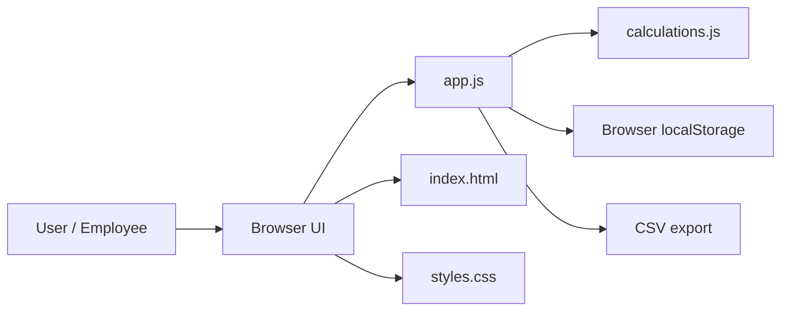
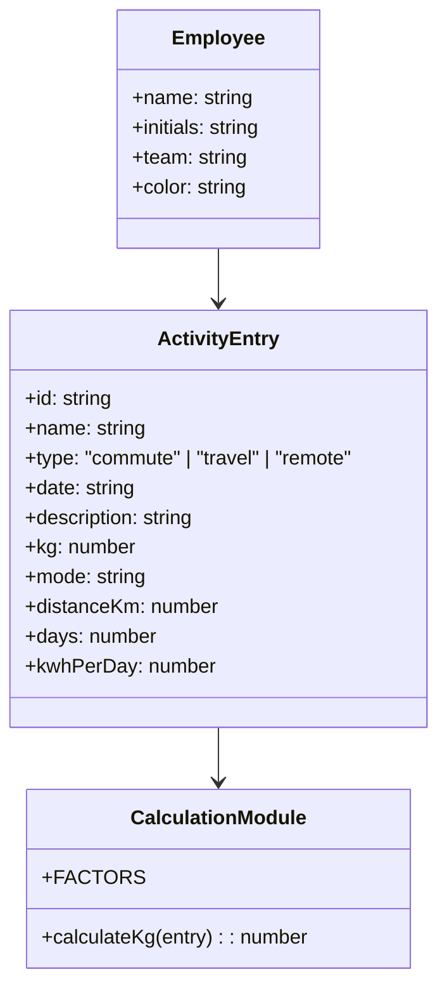
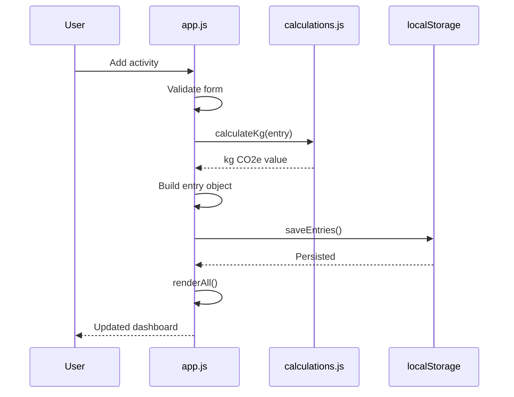
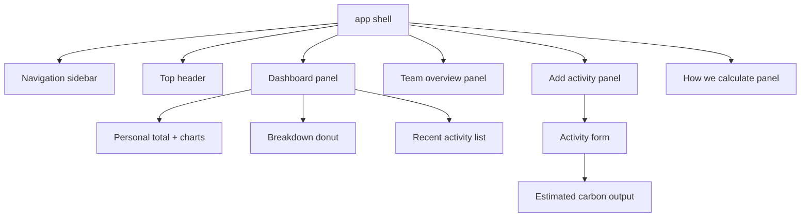
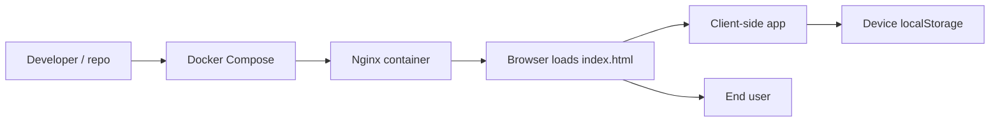

# Goodfoot Architecture

This document describes the architecture of the Goodfoot prototype: a dependency-free, browser-based carbon-footprint dashboard for employees and teams.

## 1. Architectural summary

Goodfoot is a client-side single-page application (SPA) with no backend or database. It renders its interface in the browser, stores entries in `localStorage`, and calculates emissions using a small shared calculator module.

The application intentionally keeps the architecture simple:

- A static HTML shell provides the UI structure.
- JavaScript owns state, event handling, rendering, and local persistence.
- Shared calculation logic is isolated in a pure module.
- Tests validate the emissions formulas without requiring a build step.

## 2. System context



### Responsibilities

- `index.html`: page shell, navigation, forms, and content areas.
- `styles.css`: visual design, layout, charts, cards, and responsive styling.
- `app.js`: orchestration, data loading, rendering, navigation, validation, and export.
- `calculations.js`: emission-factor logic for commute, work travel, and remote energy.
- `localStorage`: local demo persistence for user-created activity entries.
- `tests.js`: browser-based test suite for the calculation logic.

## 3. Runtime architecture

```mermaid
flowchart TD
    A[Page load] --> B[init()]
    B --> C[fillEmployeeSelect()]
    B --> D[renderTypeFields()]
    B --> E[renderAll()]
    E --> F[renderPersonal()]
    E --> G[renderTeam()]

    F --> H[totalsFor()]
    F --> I[renderTrend()]
    F --> J[renderDonut()]
    F --> K[renderRecent()]

    L[User submits activity form] --> M[getFormEntry()]
    M --> N[calculateKg(entry)]
    N --> O[saveEntries()]
    O --> P[localStorage.setItem()]
    P --> Q[renderAll()]

    R[User exports CSV] --> S[downloadCsv()]
    S --> T[Blob + download link]
```

### Key runtime behaviors

1. The app boots on page load via `init()`.
2. The dashboard renders employee totals and team aggregates from the current in-memory `entries` array.
3. The activity form collects values for commute, work travel, or remote energy.
4. The current form is converted into a structured entry and passed to `calculateKg()`.
5. Valid entries are stored in `localStorage` and then re-rendered.
6. The app exports either the user’s personal activity log or the aggregated team summary as CSV.

## 4. Domain model

The application centers on a single activity entry structure.



### Entry types

- `commute`: return-trip commute distance × days × mode factor
- `travel`: total work-trip distance × mode factor
- `remote`: daily energy consumption × days × electricity factor

## 5. Data and persistence flow



### Persistence model

The prototype persists local state using browser storage:

- `STORAGE_KEY = "goodfoot-demo-activities-v1"`
- Entries are stored as JSON under this key.
- On first visit, a demo dataset is generated and saved.
- A corrupted or missing value falls back to seeded demo data.

This design supports offline demo use without a backend, but it does not provide multi-user synchronization or shared data ownership.

## 6. UI composition

The interface is structured as a static dashboard with multiple panels:



### Main UI responsibilities

- `My footprint`: personal totals, trend chart, donutchart, recent log
- `Team overview`: aggregated group totals and participation statistics
- `Add activity`: form inputs for commute, travel, and remote work entries
- `How we calculate`: explanatory view for factors and assumptions

## 7. Calculation module design

The calculation logic is intentionally isolated in a small, pure module so formulas remain easy to document and test.

```mermaid
flowchart LR
    Entry[Activity entry] --> Calc[calculateKg(entry)]
    Calc --> Commute[commute factor]
    Calc --> Travel[travel factor]
    Calc --> Remote[remote energy factor]
    Commute --> Output[Total kg CO2e]
    Travel --> Output
    Remote --> Output
```

### Emission factors

Illustrative factors are declared in `calculations.js`:

- Commute: car 0.192, bus 0.105, train 0.041, bike 0, walk 0
- Travel: car 0.192, train 0.035, flight 0.255
- Remote energy: 0.207 kg CO2e/kWh

These values are placeholders for prototype demonstration and are not production-grade emissions factors.

## 8. Deployment model



### Deployment characteristics

- The app is static and can be hosted on GitHub Pages, Netlify, or any static file server.
- `docker-compose.yml` runs `nginx:alpine`, serves the project directory read-only on port 8080, and does not require an image build.
- Start it with `docker compose up`, then open `http://localhost:8080`.
- State is isolated per browser/device, which is suitable for a demo but not for shared organizational tracking.
- The prototype intentionally avoids authentication, authorization, and cross-user synchronization.

## 9. Testing architecture

The project includes a lightweight browser-based test file that verifies the calculation formulas.

```mermaid
flowchart TD
    tests[tests.js] --> assertions[expectKg assertions]
    assertions --> calc[calculateKg()]
    calc --> results[Test result list]
    results --> summary[Pass/fail summary]
```

The tests cover:

- commute impacts and mode weighting
- travel distances and flight factors
- remote-energy calculations
- negative and missing input handling
- immutability of the factor tables

## 10. Architectural trade-offs

### Strengths

- Extremely simple to run and reason about
- Fast to prototype and test
- Clear separation between rendering, calculation, and persistence
- Easy to host in static infrastructure

### Constraints

- No shared team data store
- No real authentication or access control
- No robust validation at the server layer
- No data synchronization across devices
- Calculation factors are illustrative and not audited for regulatory or reporting use

## 11. Recommended future evolution

A production version would likely add:

- a backend API with authenticated user accounts
- a relational or document database for team data
- scheduled jobs or reporting pipelines for emissions analysis
- stronger validation and source-controlled emission factors
- role-based permissions and audit history

## 12. Conclusion

Goodfoot is a deliberately minimal, transparent architecture designed to demonstrate work-related carbon estimation in a browser. The separation of concerns is clear: UI in HTML/CSS/JS, calculation logic in a reusable module, data in browser storage, and verification in a lightweight test harness. This makes the project easy to understand, easy to run locally, and a solid foundation for future enterprise features.
